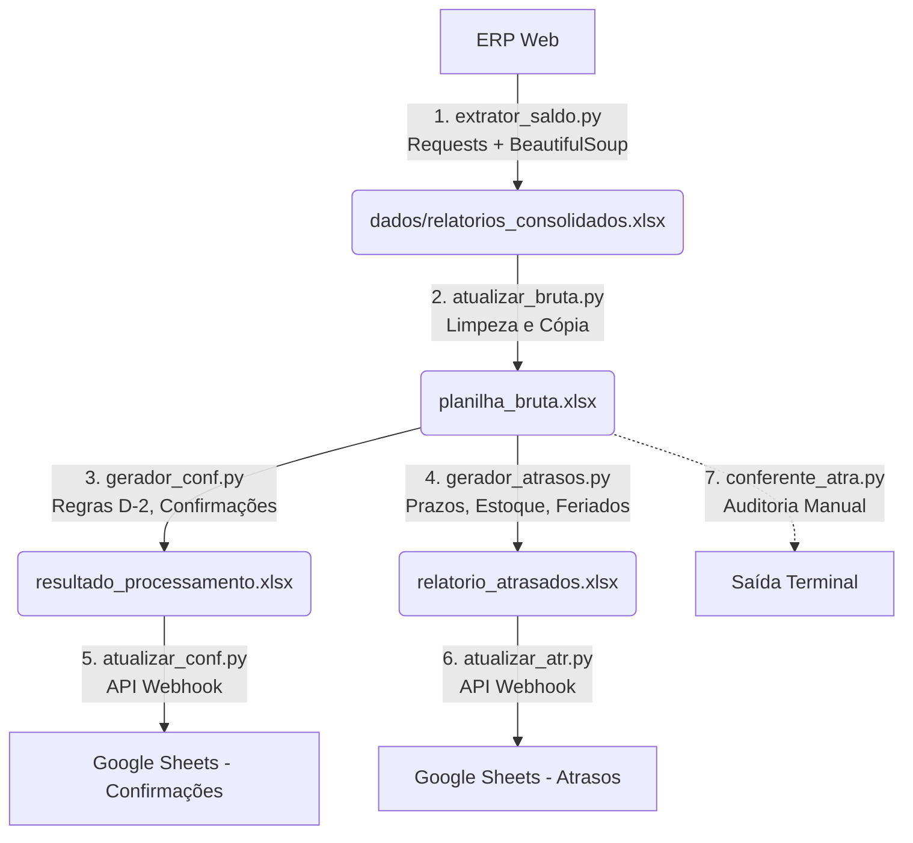

# Visão Geral do Sistema de Processamento de Pedidos e Atrasos

Este documento apresenta a arquitetura, o fluxo de execução e a visão geral dos scripts Python responsáveis pela extração, tratamento e envio de dados de pedidos, saldos e atrasos.

## 🚀 Ordem de Execução

O fluxo de processamento é sequencial e obedece rigorosamente à seguinte ordem:

1. **[extrator_saldo.py](01_extrator_saldo.md):** Extração dos relatórios do ERP via HTTP (`requests` + `BeautifulSoup`) para um arquivo Excel consolidado (`relatorios_consolidados.xlsx`).
2. **[atualizar_bruta.py](02_atualizar_bruta.md):** Transferência e limpeza dos dados do arquivo consolidado para a planilha principal de trabalho (`planilha_bruta.xlsx`).
3. **[gerador_conf.py](03_gerador_conf.md):** Processamento de regras de negócios, cruzamento de abas e aplicação de cortes de datas (D-2) para gerar a base de confirmação de entregas (`resultado_processamento.xlsx`).
4. **[gerador_atrasos.py](04_gerador_atrasos.md):** Análise aprofundada de prazos, estoque e feriados para identificar pedidos atrasados e gerar status de ações como "AVISAR" ou "REAVISAR ATRASO" (`relatorio_atrasados.xlsx`).
5. **[atualizar_conf.py](05_atualizar_conf.md):** Exportação dos dados da aba de confirmação do dia via Webhook para o Google Sheets.
6. **[atualizar_atr.py](06_atualizar_atr.md):** Exportação dos dados de análise de atrasos via Webhook para o Google Sheets.

### 🛠️ Ferramentas Adicionais
* **[conferente_atra.py](07_conferente_atra.md):** Script executado esporadicamente para auditar, via terminal, os motivos pelos quais um pedido específico foi classificado (ou não) como atrasado, simulando passo a passo as regras do `gerador_atrasos.py`.

## 🗺️ Diagrama de Fluxo

## 📁 Arquitetura de Arquivos de Dados

O sistema utiliza os seguintes arquivos de Excel como ponte entre as etapas:
* `dados/relatorios_consolidados.xlsx`: Dados brutos recém-extraídos do sistema (HTML Tables formatados).
* `planilha_bruta.xlsx`: Base de dados central contendo os dados extraídos, tabelas de de/para (canais, atendente) e histórico.
* `resultado_processamento.xlsx`: Arquivo final contendo a análise de confirmações separadas por D-2.
* `relatorio_atrasados.xlsx`: Arquivo final contendo as diretrizes de quem avisar/reavisar sobre atrasos.
* `Feriados.xlsx`: Lista de feriados utilizada para calcular dias úteis.
